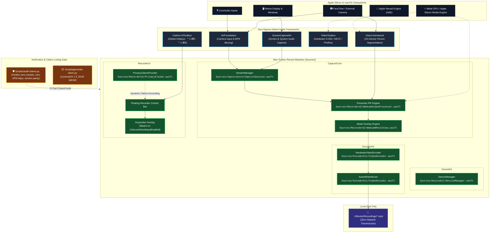
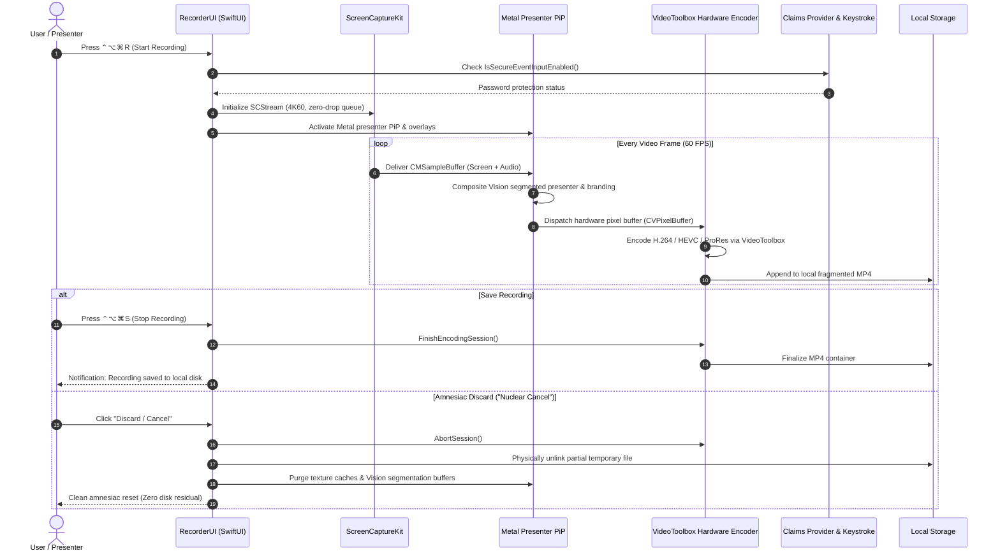

<!-- diagram-meta
  last-validated: 2026-10-26
  validated-commit: 6b92f53
  covers: [Sources/**, Package.swift, Resources/**, Scripts/**]
  generated-by: manual
-->

# Architecture & Invariants Specification: Mac Screen Record

> Pure native macOS zero-egress screen recorder, evidence capture studio, and hardware-accelerated presenter engine.

---

## 1. Executive Summary

`mac-screen-record` is the native macOS desktop engine in the `knowthankyew` portfolio built for capturing unassailable evidence of consumer fraud, billing discrepancies, and subscription dark patterns. Operating with strict zero external dependencies and guaranteed compile-time air-gapping (zero network frameworks or socket primitives), it uses macOS native frameworks (`ScreenCaptureKit`, `VideoToolbox`, `Vision`, `Metal`) to capture 4K60 video, audio, and webcam presenter PiP directly on local Apple Silicon, validated continuously by `Scripts/audit-claims.py`.

---

## 2. System Architecture & Pipeline Boundaries

### A. Execution Sandbox & Hardware Acceleration Boundary



### B. Capture, Hardware Encode & Amnesiac Purge Lifecycle



---

## 3. Core Architectural Invariants

| # | Invariant | Description & Enforcement |
|:--|:----------|:--------------------------|
| 1 | **Zero-Egress Air-Gap** | Zero networking frameworks (`Network`, `CFNetwork`, `WebKit`) and zero BSD sockets (`socket`, `connect`, `URLSession`) exist in source tree; enforced fail-closed by `Scripts/audit-claims.py`. |
| 2 | **Zero Remote SPM Dependencies** | `Package.swift` contains zero external package URLs (`url:` forbidden). All capabilities built on Apple first-party SDKs. |
| 3 | **Password Masking Protection** | Keystroke overlay inspects `IsSecureEventInputEnabled()` before rendering; automatically suppresses password keystrokes. |
| 4 | **Dynamic UI Claims Parity** | `PrivacyClaimsProvider.currentClaims()` dynamically confirms zero egress, air-gap status, and memory isolation to the SwiftUI interface. |
| 5 | **Hardware-Accelerated Encoding** | Uses VideoToolbox hardware encoders directly with zero software CPU transcode bottlenecks. |

---

## 4. Directory Structure

```
mac-screen-record/
├── Package.swift                # Zero remote dependency package manifest
├── Resources/
│   ├── Info.plist               # App metadata, bundle identifier & permissions
│   └── MacScreenRecord.entitlements # Hardened runtime entitlements
├── Scripts/
│   ├── audit-claims.py          # Architectural claims, zero-egress & parity linter
│   ├── build-app.sh             # App bundle packager & code signing runner
│   ├── generate-sbom.py         # CycloneDX 1.5 JSON SBOM generator
│   └── setup-stable-signing.sh  # Code signing identity configuration
├── Sources/
│   ├── CaptureCore/             # ScreenCaptureKit, Metal PiP & Vision segmentation
│   ├── DeviceKit/               # Display, camera & audio input enumerators
│   ├── EncoderKit/              # VideoToolbox hardware encoder & MP4 writer
│   ├── MacScreenRecord/         # App executable entrypoint
│   └── RecorderUI/              # SwiftUI controls, hotkeys & PrivacyClaimsProvider
├── Tests/
│   └── MacScreenRecordTests/    # Unit tests for capture, encoders & claims
└── docs/
    ├── ARCHITECTURE.md          # Architecture, data flow & invariant specification
    ├── QA_CHECKLIST.md          # Release qualification procedure
    ├── RELEASE_NOTES.md         # Version history & changelogs
    └── ROADMAP.md               # Feature phases & milestones
```
